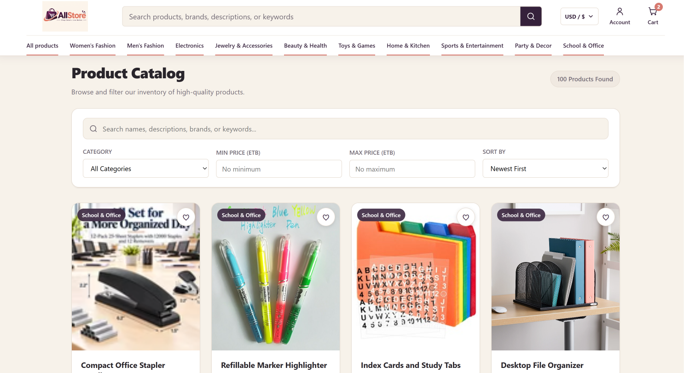
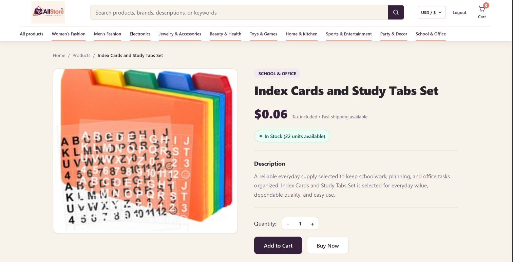
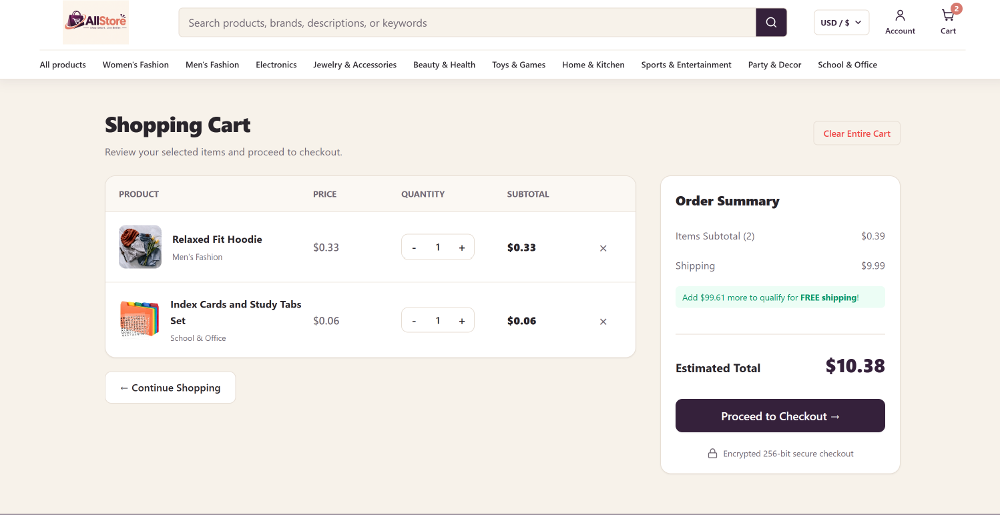
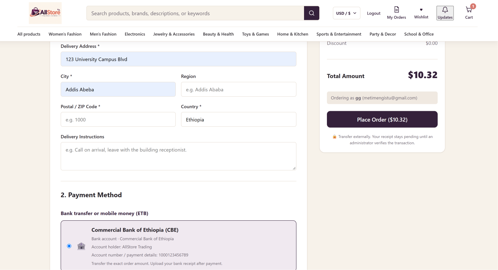
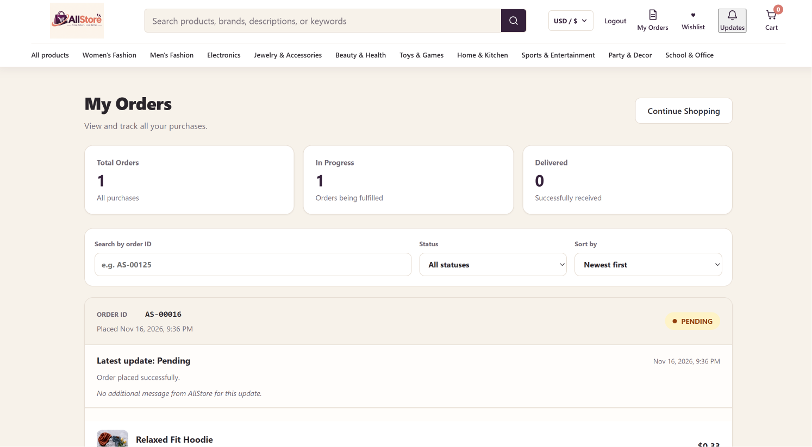
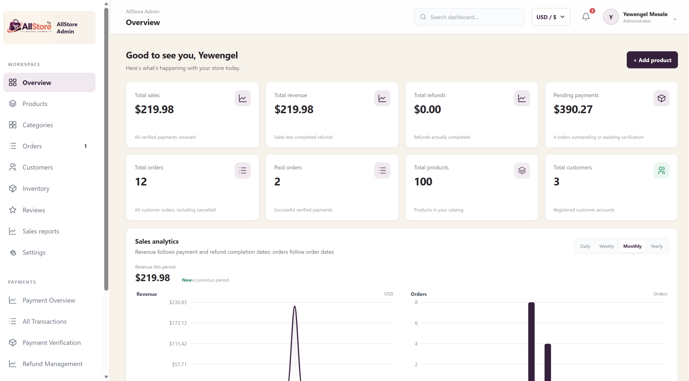
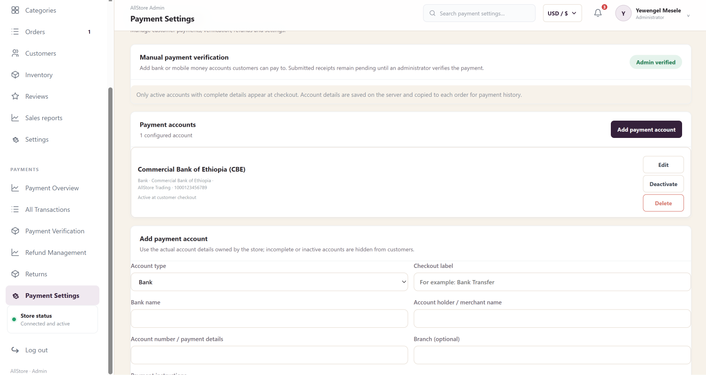
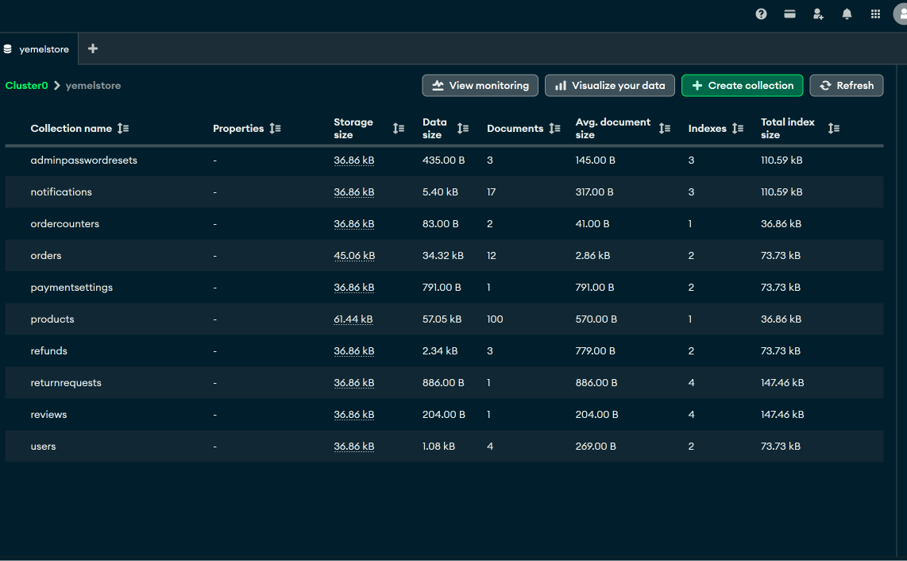
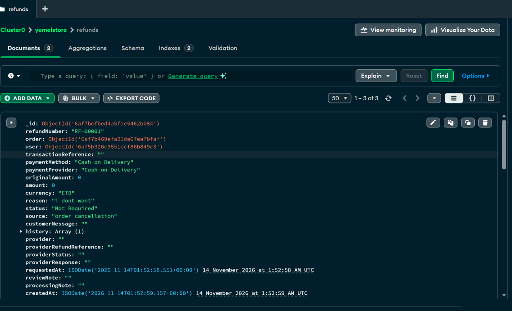

# AllStore - MERN Stack E-Commerce Platform
> **Shop Smart. Live Better.**
> Full-Stack Retail Web Application built with MongoDB, Express.js, React.js, and Node.js.

---

## 1. Project Overview

**AllStore** is a modern, responsive, full-stack e-commerce web application engineered for small-to-medium retail businesses. The platform enables customers to browse a dynamic catalog, search and filter items, manage a shopping cart, and place orders with real-time stock deduction. It simultaneously provides a secure, role-protected administrative dashboard where store owners manage product inventory (including image uploads via Multer) and update customer order fulfillment statuses.

### Tech Stack
* **Database:** MongoDB Atlas (Cloud NoSQL Database with Mongoose ODM)
* **Backend:** Node.js & Express.js (RESTful API architecture)
* **Frontend:** React 19, Vite, React Router 7, Axios
* **Authentication:** JSON Web Tokens (JWT) & Bcrypt password hashing
* **File Uploads:** Multer multipart/form-data storage
* **Styling:** Custom responsive CSS design system (zero third-party CSS dependencies)

---

## 2. User Roles & Permissions

| Capability | Customer (Default) | Admin (Store Owner) |
|---|:---:|:---:|
| User Registration & Login | ✅ | ✅ |
| Browse, Search & Filter Products | ✅ | ✅ |
| Product Details View | ✅ | ✅ |
| Add to Cart & Checkout | ✅ | ❌ |
| Automatic Stock Deduction on Order | ✅ | ❌ |
| View Personal Order History ("My Orders") | ✅ | ❌ |
| Create, Update, Delete Products | ❌ | ✅ |
| Upload Product Images via Multer | ❌ | ✅ |
| View All Orders from All Customers | ❌ | ✅ |
| Update Order Status (`Pending` &rarr; `Delivered`) | ❌ | ✅ |
| Access Admin Dashboard (`/admin`) | ❌ (Returns `403 Forbidden`) | ✅ |

---

## 3. Core Features

### A. Authentication & Authorization
* **JWT Authentication:** Tokens are signed by the backend and verified on every protected request.
* **Bcrypt Password Hashing:** Passwords are never stored in plain text; hashed using 10 salt rounds before persistence.
* **Role-Based Middleware:**
  * `protect`: Verifies the Bearer token in the `Authorization` header.
  * `admin`: Verifies `req.user.role === 'admin'`. Returns `403 Forbidden` if a customer attempts unauthorized access.
* **Admin password reset:** The secure admin login offers a time-limited, email-delivered verification code. Only an account with the `admin` role can reset its password; codes and reset tokens are stored as keyed hashes, expire after 10 minutes, and are protected by attempt limits and resend cooldowns.
* **Customer password reset:** Customer accounts use the same SMTP configuration and one-time verification process. The flow is restricted to accounts with the `customer` role and does not reveal whether an email is registered.

### B. Product Management (Admin)
* Admins can create products with `name`, `description`, `price`, `category`, `subcategory`, `brand`, searchable `keywords`, `stockQuantity`, and `image`.
* **Multer File Upload:** Real image uploads (`JPG`, `PNG`, `WEBP`) processed and served statically at `/uploads`.
* Product updates with optional image replacements and complete product deletion with database cleanup.

### C. Product Browsing (Customer)
* Debounced, case-insensitive partial search across product names, descriptions, categories, subcategories, brands, and admin-provided keywords. Multiple search terms can match across those fields.
* Database-backed category, subcategory, and brand filters can be combined with search and an ETB minimum/maximum price range.
* Sorting supports newest, price low-to-high/high-to-low, name, and popularity (ordered units, excluding cancelled orders).
* Search and filter values are shareable in the catalog URL; the storefront shows the matching count, a no-results state, and a reset action.
* Dedicated Product Details view with responsive image gallery, quantity selectors, and live stock indicators.

### D. Shopping Cart & Checkout
* Local state and `localStorage` persistence for instant, reliable cart retention across page reloads.
* Subtotal calculations, free shipping thresholds, and item quantity adjusters.
* **Database Stock Management:** Placing an order decreases each product's `stockQuantity` atomically. If quantity is insufficient, the transaction is rejected with an informative message.
* Customer-facing product prices use the selected currency (USD by default; ETB, EUR, GBP, CHF, CAD, and MXN are available). Configure the `VITE_<CURRENCY>_PER_USD` rates in `frontend/.env` as units of that currency per USD. Non-ETB fallbacks are a reference snapshot from 2026-11-12; ETB stays at `164.62` to match the backend. Refresh rates for production. Admin analytics continue to show ETB and USD together.
* New and edited product prices are entered and stored in ETB. Existing products and historical orders are not migrated: records without a currency marker are treated as legacy USD, and new orders store ETB snapshots.

### E. Customer Order Management
* Authenticated customers can search, filter, and sort their order history, view order totals and product snapshots, and see order-count summaries.
* New orders receive a backend-generated, sequential customer-facing ID (`AS-00001`, `AS-00002`, etc.); the atomic MongoDB counter is incremented within the order transaction. MongoDB `_id` values remain in use for database relationships and API operations.
* On backend startup, existing orders with legacy or missing readable IDs are assigned short IDs without changing their MongoDB `_id` values.
* Dedicated order details and tracking pages show payment, delivery, pricing, and timestamped status-history information.
* Administrators can search and filter by order/customer/payment status, sort by date or converted order amount, review full customer/address/product/payment details, and update status separately from delivery information. Payment status is stored separately from fulfillment status.
* Status updates accept only the next fulfillment stage (or eligible pre-shipment cancellation), use an atomic compare-and-set, and append previous/new status, timestamp, admin note, and admin user ID to history. Orders cannot move to `Processing` or shipping unless payment is verified and marked paid.
* Delivery tracking supports AllStore Delivery by default, optional tracking and delivery-person details, estimated/shipping/actual delivery dates, customer instructions, admin tracking notes, and transaction references. Legacy orders receive missing tracking defaults and a history entry when needed.
* Checkout collects a delivery phone number and stores it with the order.
* Customers can buy available products again and cancel unpaid orders only while they are `Pending` or `Confirmed`; cancellation restores their stock in the same database transaction.
* Customers can view only their own order details and tracking. Admins retain access to all orders and manage fulfillment using the existing dashboard.
* Order statuses: `Pending`, `Confirmed`, `Processing`, `Shipped`, `Out for Delivery`, `Delivered`, and `Cancelled`.

### F. Payments
* Customer checkout supports only configured, active bank and mobile-money accounts. Cash on Delivery and Chapa checkout are not offered for new orders.
* Add, edit, activate, deactivate, and delete store-owned payment accounts in Admin Dashboard → Payment Settings. Each account requires a checkout label, provider, account holder, and account details. Branch and payment instructions are optional. No account credentials are seeded or supplied by the application.
* Customers pay the exact server-calculated order total, may enter a transaction reference, and must upload a JPG/JPEG, PNG, or PDF receipt (maximum 5 MB). Receipts are signature-checked and stored outside public static uploads. Uploading proof sets the payment to `Pending Verification`; it does not mark the order paid.
* Only authenticated administrators can view receipts and confirm/reject submitted proofs. Confirmation records the administrator, date, and expected amount; rejection requires a customer-visible reason and permits corrected proof. Payment history stays on the MongoDB order record.
* Payment and delivery statuses are separate. Unpaid/unverified orders cannot move to `Processing` or shipping. Verified orders count toward revenue; refunds remain incomplete until the actual payout is confirmed.

### G. Customer Bonus Features
* Customers can submit 1–5 star reviews only for products in their delivered orders. Reviews are unique per customer/product/order, start pending, and appear publicly only after Admin approval.
* Homepage and catalog pages show 10 products per page using MongoDB pagination. Catalog page links preserve the search, category, subcategory, brand, price, and sort query parameters.
* Unknown routes and invalid/missing product IDs show a branded AllStore 404 page with Home and Continue Shopping links.
* Authenticated customers have a MongoDB-backed wishlist, can add saved products to their cart, and see recently viewed products. Guest recently-viewed product IDs are kept in local browser storage.
* Order, payment, return, and refund events create persistent customer notifications. Customers can review updates and mark one or all as read from the navigation notification menu.

---

## 4. REST API Documentation

### Base URL: `http://localhost:5000/api`

### Health Check
| Method | Endpoint | Access | Description |
|---|---|---|---|
| `GET` | `/health` | Public | Returns `{ status: "success", message: "..." }` |

### Authentication (`/api/auth`)
| Method | Endpoint | Access | Body / Params | Description |
|---|---|---|---|---|
| `POST` | `/api/auth/register` | Public | `{ name, email, password }` | Registers a customer, returns JWT and user profile |
| `POST` | `/api/auth/login` | Public | `{ email, password }` | Authenticates user, returns JWT and user profile |
| `GET` | `/api/auth/profile` | Private | Header: `Bearer <token>` | Returns logged-in user profile |
| `POST` | `/api/auth/admin/password-reset/request` | Public, rate-limited | `{ email }` | Sends a code only to an admin; always returns a generic response |
| `POST` | `/api/auth/admin/password-reset/verify` | Public, rate-limited | `{ email, code }` | Consumes a valid code and returns a short-lived reset token |
| `POST` | `/api/auth/admin/password-reset/reset` | Public, rate-limited | `{ email, resetToken, newPassword }` | Changes the admin password and invalidates the reset token |
| `POST` | `/api/auth/customer/password-reset/request` | Public, rate-limited | `{ email }` | Sends a code only to a customer; always returns a generic response |
| `POST` | `/api/auth/customer/password-reset/verify` | Public, rate-limited | `{ email, code }` | Consumes a valid code and returns a short-lived reset token |
| `POST` | `/api/auth/customer/password-reset/reset` | Public, rate-limited | `{ email, resetToken, newPassword }` | Changes the customer password and invalidates the reset token |

### Products (`/api/products`)
| Method | Endpoint | Access | Body / Params | Description |
|---|---|---|---|---|
| `GET` | `/api/products` | Public | Query: `keyword/search, category, subcategory, brand, minPrice/maxPrice (ETB), sort` | Fetch products with combined text search and catalog filters |
| `GET` | `/api/products/categories` | Public | None | Returns list of distinct product categories |
| `GET` | `/api/products/filters` | Public | Optional `category` | Returns database-backed category, subcategory, and brand filter options |
| `GET` | `/api/products/:id` | Public | Path: `id` | Get single product details |
| `POST` | `/api/products` | Admin | Multipart: `name, description, price (ETB), category, subcategory, brand, keywords, stockQuantity, image` | Create new ETB-priced product with searchable metadata |
| `PUT` | `/api/products/:id` | Admin | Multipart: updated fields (`price` in ETB; keywords are comma-separated) + optional `image` | Update existing product |
| `DELETE` | `/api/products/:id` | Admin | Path: `id` | Delete product from database |
| `GET` | `/api/products/:productId/reviews` | Public | Path: product `id` | Returns approved reviews, average rating, and review count |
| `POST` | `/api/products/:productId/reviews` | Customer | `{ orderId, rating, body }` | Submits a review for a product in a delivered order; each purchase can be reviewed once |
| `GET` | `/api/admin/reviews` | Admin | None | Lists customer reviews awaiting moderation |
| `PATCH` | `/api/admin/reviews/:id` | Admin | `{ status: "Approved" \| "Rejected", moderationNote? }` | Approves or rejects a pending review |

### Orders (`/api/orders`)
| Method | Endpoint | Access | Body / Params | Description |
|---|---|---|---|---|
| `POST` | `/api/orders` | Customer | `{ orderItems: [{ product, qty }], shippingAddress, paymentMethod }` | Prices from MongoDB, assigns a readable `orderNumber` (for example `AS-00125`), stores the order in ETB, and decrements product stock |
| `GET` | `/api/orders/my-orders` | Customer | None | Returns logged-in customer's past orders |
| `GET` | `/api/orders/:id` | Owner / Admin | Path: `id` | Returns order details if owner or store admin |
| `PATCH` | `/api/orders/:id/cancel` | Owner | Path: `id` | Cancels a pending/confirmed order and returns available items to inventory |
| `GET` | `/api/orders` | Admin | None | Returns all orders from all customers |
| `PUT` | `/api/orders/:id/status` | Admin | `{ status, adminNote }` | Applies a valid next status and appends an audited history entry |
| `PATCH` | `/api/orders/:id/tracking` | Admin | Optional status, admin note, tracking and delivery fields | Updates delivery fields independently; when status changes, stores previous/new status, timestamp, admin note, and admin user ID |

### Customer Features
| Method | Endpoint | Access | Body / Params | Description |
|---|---|---|---|---|
| `GET` | `/api/customer/wishlist` | Customer | None | Returns the signed-in customer's saved products |
| `POST` | `/api/customer/wishlist/:productId` | Customer | Path: product `id` | Adds a product to the wishlist |
| `DELETE` | `/api/customer/wishlist/:productId` | Customer | Path: product `id` | Removes a product from the wishlist |
| `GET` | `/api/customer/recently-viewed` | Customer | None | Returns up to 12 recently viewed products |
| `POST` | `/api/customer/recently-viewed/:productId` | Customer | Path: product `id` | Records a viewed product |
| `GET` | `/api/customer/notifications` | Customer | None | Lists the customer's most recent notifications |
| `PATCH` | `/api/customer/notifications/:id/read` | Customer | Path: notification `id` | Marks an owned notification as read |
| `PATCH` | `/api/customer/notifications/read-all` | Customer | None | Marks all unread customer notifications as read |

### Payments
| Method | Endpoint | Access | Body / Params | Description |
|---|---|---|---|---|
| `GET` | `/api/payment-settings/public` | Public | None | Returns only active, completely configured customer payment destinations; response is not cached |
| `GET` | `/api/payment-settings` | Admin | None | Reads all payment settings, including incomplete and inactive methods |
| `PUT` | `/api/payment-settings` | Admin | `disabledMethods`, `bankTransfer`, `telebirr`, `cbeBirr` | Validates and saves the shared MongoDB payment settings |
| `POST` | `/api/payments/bank-transfer/:id/receipt` | Order owner | Multipart `receipt`; optional `transactionReference` | Uploads or replaces payment proof and sets the order to `Pending Verification` |
| `GET` | `/api/payments/bank-transfer/:id/receipt` | Order owner | Path: order `id` | Downloads the caller's own payment proof |
| `GET` | `/api/admin/payments/bank-transfers?status=awaiting` | Admin | Optional status: `awaiting`, `reviewed`, or `rejected` | Lists manual payment orders for verification |
| `GET` | `/api/admin/payments/bank-transfers/:id/receipt` | Admin | Path: order `id` | Downloads an uploaded payment proof |
| `PATCH` | `/api/admin/payments/bank-transfers/:id/review` | Admin | `{ decision: "approve" \| "reject", note }` | Confirms or rejects pending proof; rejection requires a reason |

The previous `/api/payments/config` and `/api/admin/payments/settings` endpoints remain available for compatibility; the active checkout and Admin settings page use `/api/payment-settings`.

No email delivery integration is configured. Payment decisions and rejection reasons are recorded as customer-visible order payment updates; customers see them when their order data is fetched again.

---

## 5. Local Development Setup

### Prerequisites
* [Node.js](https://nodejs.org/) (v18 or higher)
* [MongoDB](https://www.mongodb.com/) (Local instance or MongoDB Atlas free cloud cluster)

### Step 1: Clone the Repository
```bash
git clone <repository-url>
cd ecommerce-platform
```

### Step 2: Configure Backend Environment
Create a `.env` file in the `backend/` directory:
```bash
cd backend
cp .env.example .env
```

Open `backend/.env` and update the variables:
```env
PORT=5000
NODE_ENV=development
CLIENT_URL=http://localhost:5173
MONGO_URI=mongodb+srv://<username>:<password>@cluster0.example.mongodb.net/ecommerce?retryWrites=true&w=majority
JWT_SECRET=super_secret_jwt_key_replace_in_production
ETB_PER_USD=164.62
```

Create `frontend/.env` from `frontend/.env.example` and keep `VITE_ETB_PER_USD` aligned with the backend rate. Set each additional `VITE_<CURRENCY>_PER_USD` value to the number of units of that currency per US dollar.
Set `VITE_SUPPORT_EMAIL` to the store's customer-support email for order support links.

### Step 3: Seed Sample Products (Optional but Recommended)
Add or update 10 sample products in each of the 10 catalog categories:
```bash
cd backend
npm run seed
```
The seeder uses the existing Product model and is safe to re-run; it does not delete products, users, or orders. Configure a working `MONGO_URI` in `backend/.env` first. Use `npm run seed:destroy` only when intentionally clearing all database data.

### Step 4: Run the Application
Open two separate terminal windows:

#### Terminal 1 — Backend:
```bash
cd backend
npm run dev
```
*Backend runs on `http://localhost:5000` with live reload via Nodemon.*

#### Terminal 2 — Frontend:
```bash
cd frontend
npm run dev
```
*Frontend runs on `http://localhost:5173` via Vite.*

---

## 6. GitHub Collaboration Workflow

Per project requirements, team members contribute via feature branches and Pull Requests:
```bash
# 1. Fetch latest main
git checkout main
git pull origin main

# 2. Create a dedicated feature branch
git checkout -b feature-auth
# or: git checkout -b feature-cart
# or: git checkout -b feature-admin

# 3. Commit your changes
git add .
git commit -m "feat(auth): add JWT authentication and role authorization"

# 4. Push branch to GitHub
git push origin feature-auth

# 5. Open a Pull Request on GitHub for peer review and merge into main
```

---

## 7. Production Deployment Guide

### A. Database (MongoDB Atlas)
1. Sign up on [MongoDB Atlas](https://www.mongodb.com/atlas) and deploy a free M0 cluster.
2. Under **Database Access**, create a user with Read and Write privileges.
3. Under **Network Access**, add IP `0.0.0.0/0` (allow access from anywhere) so cloud platforms like Render can connect.
4. Copy your connection string into your production environment variables.

### B. Backend Deployment (Render)
1. Push your project to GitHub.
2. Sign in to [Render](https://render.com/) and click **New +** &rarr; **Web Service**.
3. Select your repository.
4. Configure settings:
   * **Root Directory:** `backend`
   * **Build Command:** `npm install`
   * **Start Command:** `node server.js`
5. Add Environment Variables:
   * `NODE_ENV`: `production`
   * `PORT`: `10000`
   * `MONGO_URI`: `your_mongodb_atlas_connection_string`
   * `JWT_SECRET`: `your_secure_random_jwt_secret`
   * `ETB_PER_USD`: `164.62` (keep this in sync with the frontend's `VITE_ETB_PER_USD`)
   * `CLIENT_URL`: `https://your-frontend-domain.vercel.app`
   * `SMTP_HOST`: your email provider's SMTP hostname
   * `SMTP_PORT`: `587` for STARTTLS, or `465` for implicit TLS
   * `SMTP_SECURE`: `false` for port `587`; `true` for port `465`
   * `SMTP_USER`: the SMTP username supplied by your email provider
   * `SMTP_PASS`: the SMTP password or provider-issued app password
   * `SMTP_FROM`: the verified sender, for example `AllStore <no-reply@your-domain.com>`

   Add these SMTP variables to the **Render backend service only**. Never add `SMTP_USER`, `SMTP_PASS`, or other SMTP credentials to Vercel or `VITE_*` variables. Use values issued by your email provider; `.env.example` contains placeholders only. Email delivery must be verified with the provider's real credentials before enabling the feature in production.

### C. Frontend Deployment (Vercel)
1. Sign in to [Vercel](https://vercel.com/) and click **Add New** &rarr; **Project**.
2. Import your GitHub repository.
3. Configure settings:
   * **Root Directory:** `frontend`
   * **Framework Preset:** Vite
   * **Build Command:** `npm run build`
   * **Output Directory:** `dist`
4. Add Environment Variable:
   * `VITE_API_URL`: `https://your-backend-app.onrender.com/api`
   * `VITE_ETB_PER_USD`: `164.62` (keep this in sync with the backend's `ETB_PER_USD`)
   * `VITE_EUR_PER_USD`: `0.899865` (euros per US dollar)
   * `VITE_GBP_PER_USD`: `0.752421` (pounds per US dollar)
   * `VITE_CHF_PER_USD`: `0.831838` (francs per US dollar)
   * `VITE_CAD_PER_USD`: `1.423964` (Canadian dollars per US dollar)
   * `VITE_MXN_PER_USD`: `18.62736` (Mexican pesos per US dollar)
5. Click **Deploy**.
---

---

## Screenshots

### 1. Homepage


### 2. Product Catalog


### 3. Product Details


### 4. Shopping Cart


### 5. Checkout


### 6. Customer Orders


### 7. Admin Dashboard


### 8. Admin Product Management


### 9. Admin Order Management


### 10. Payment Management
